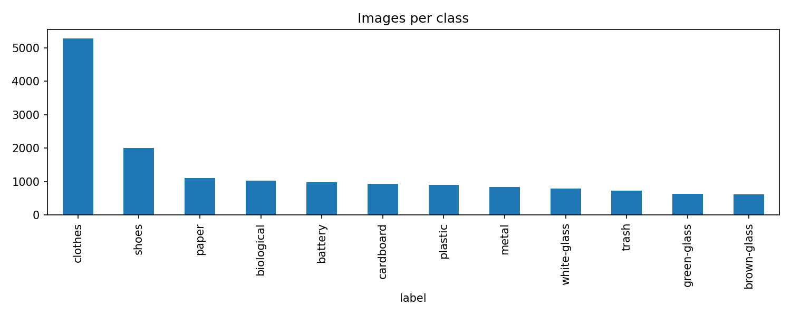
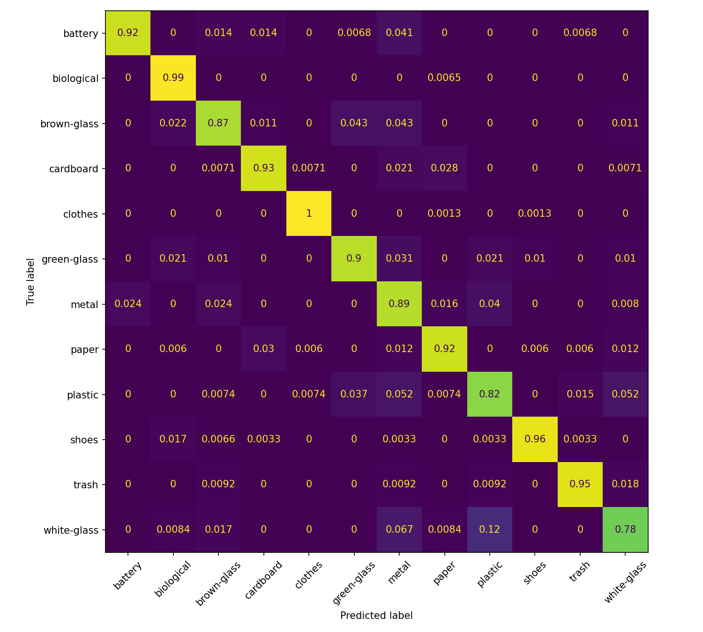

# AI-based Waste Identification and Disposal Assistant

A mini project that identifies a waste item from a photo and tells the user which bin it belongs in, following the segregation streams of India's Solid Waste Management Rules, 2026.

**Live app:** https://ai-waste-assistant.streamlit.app

*Project status: first milestone (about 40%) complete. Working classifier, evaluation, and a deployed web app. Improving real-world accuracy is the next phase.*

## What it does

1. The user uploads a photo or takes one with the camera.
2. A MobileNetV2 model classifies the item into one of 12 waste classes.
3. The class is mapped to a bin stream (wet, dry, or special care) with a short disposal tip.
4. If the model's confidence is below a threshold (60% by default, adjustable in the sidebar), the app says it is not sure instead of guessing.

## Team

- Abhishek Prasad
- Alquama Sheikh
- Adweta Arya
- Abhijeet Gorai

Supervisor: Prof. Abhishek Kumar
[Dept. of AI & ML, RVSCET, Jamshedpur]

## Dataset

We used the **Garbage Classification (12 classes)** dataset, in the enhanced version with corrected labels and duplicates removed.

- Kaggle: `huberthamelin/garbage-classification-labels-corrections` (folder `garbage_classification_enhanced`)
- Original dataset by Mostafa Mohamed on Kaggle
- 15,870 images in 12 classes: battery, biological, brown-glass, cardboard, clothes, green-glass, metal, paper, plastic, shoes, trash, white-glass

Cleaning: two pairs of images appeared under two different classes (the same picture labelled differently), so those 4 files were excluded, leaving 15,866 images. The data was split 70/15/15 with stratification (11,106 train, 2,380 validation, 2,380 test, seed 42).

The dataset is not stored in this repository. The classes are imbalanced (`clothes` is about a third of all images), so we used class weights during training and report macro F1 alongside accuracy.



## Model

- Base: MobileNetV2 pretrained on ImageNet, frozen (transfer learning)
- Head: global average pooling, dropout 0.3, dense layer with 12 softmax outputs
- Input: 224 x 224 RGB, with augmentation during training (flip, rotation, zoom, brightness)
- Training: Adam (learning rate 1e-3), balanced class weights, early stopping on validation accuracy (best epoch: 8)
- Trained on Google Colab (T4 GPU) using TensorFlow 2.21 and Keras 3.13

## Results

Evaluated once on the held-out test set of 2,380 images.

| Metric | Value |
|---|---|
| Accuracy | 94.1% |
| Macro F1 | 0.911 |
| Weighted F1 | 0.941 |

Per-class F1: clothes 0.997, shoes 0.976, biological 0.963, trash 0.954, battery 0.947, cardboard 0.932, paper 0.930, green-glass 0.896, brown-glass 0.866, plastic 0.825, metal 0.819, white-glass 0.819.

The weakest classes (plastic, metal, white-glass) are mostly confused with each other, which makes sense visually since all three can be transparent or shiny. These all go in the same dry-waste stream, so such confusions do not change the bin advice.



## Real-world testing and known limitations

The dataset photos are cleaner than typical phone photos, so accuracy in everyday use is lower than the test-set numbers above. We tested with our own phone photos and logged the results in [`docs/realworld_results.md`](docs/realworld_results.md). So far:

- Plastic bottles, cardboard, fruit and vegetables, shoes and printed paper (such as receipts) were generally recognised correctly.
- Blank paper was misclassified as clothes with high confidence.
- Steel utensils and tumblers, and small batteries, often came back as "not sure" or were misclassified.
- A black polythene bag was misclassified as clothes, and a clear drinking glass as metal.
- Cluttered backgrounds seem to hurt accuracy. The app works best with a single item, plain background and good light.
- The `trash` class in the dataset consists almost entirely of used masks, so it is not a general "other waste" class.
- The dataset has no sanitary waste class, so the sanitary stream is out of scope for the classifier.

This is a prototype, and its output is a suggestion, not an official ruling. Local municipal guidelines apply.

## Run locally

Requires Python 3.10 to 3.13 (developed on 3.13).

```bash
git clone https://github.com/abhishek07-prog/ai-waste-assistant.git
cd ai-waste-assistant
python -m venv .venv
# Windows:  .venv\Scripts\activate
# macOS/Linux:  source .venv/bin/activate
pip install -r requirements.txt
streamlit run app/app.py
```

The trained model (`models/model_baseline.keras`) and class names (`models/class_names.json`) are included in the repository, so no training is needed to run the app.

## Retraining

Open the notebook in `notebooks/` in Google Colab with a GPU runtime and run the cells in order. The notebook downloads the dataset from Kaggle, builds the split, trains the model and evaluates it. The trained model is saved to Google Drive.

## Repository structure

```
app/          Streamlit app (app.py) and class-to-bin mapping (bin_map.json)
models/       Trained model and class names
notebooks/    Colab notebook: data split, training, evaluation
assets/       Figures (class distribution, samples, confusion matrix)
docs/         Real-world test results
requirements.txt
```

## Next steps

- Collect our own phone photos for the weak spots (blank paper, steel items, plastic bags, clear glass, small batteries) and add them to training.
- Reduce the dominance of the `clothes` class and fine-tune the top layers of MobileNetV2.
- Keep a separate held-out set of our own photos so before/after improvements can be measured fairly.

## Acknowledgements

- Dataset: Mostafa Mohamed (original) and the enhanced version on Kaggle
- MobileNetV2: Sandler et al., 2018
- Bin streams based on the Solid Waste Management Rules, 2026 (MoEFCC, India)